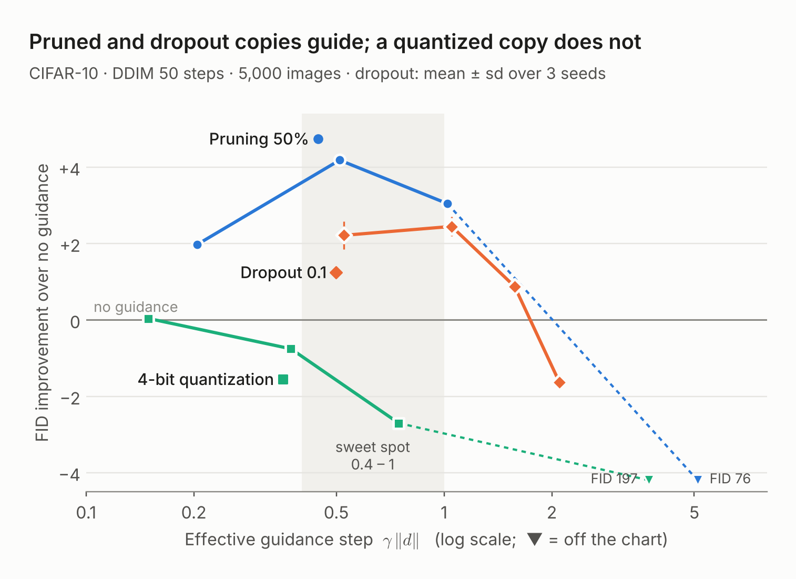
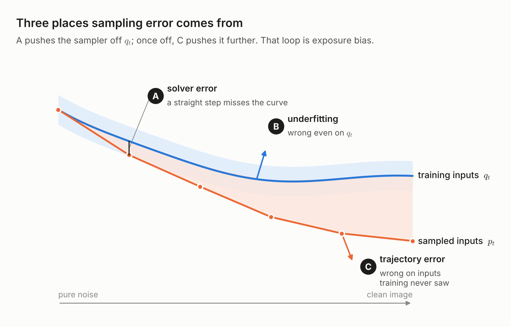
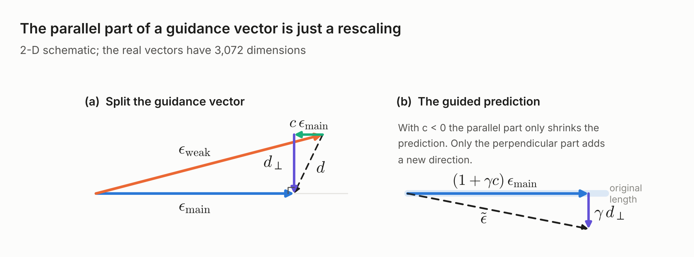
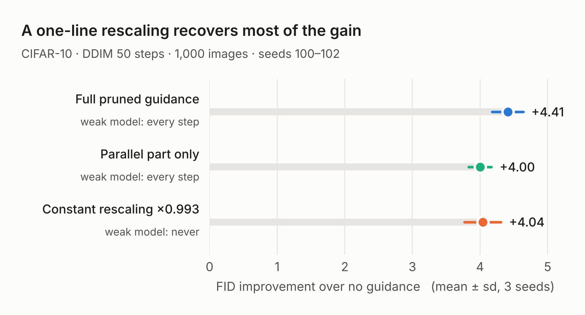
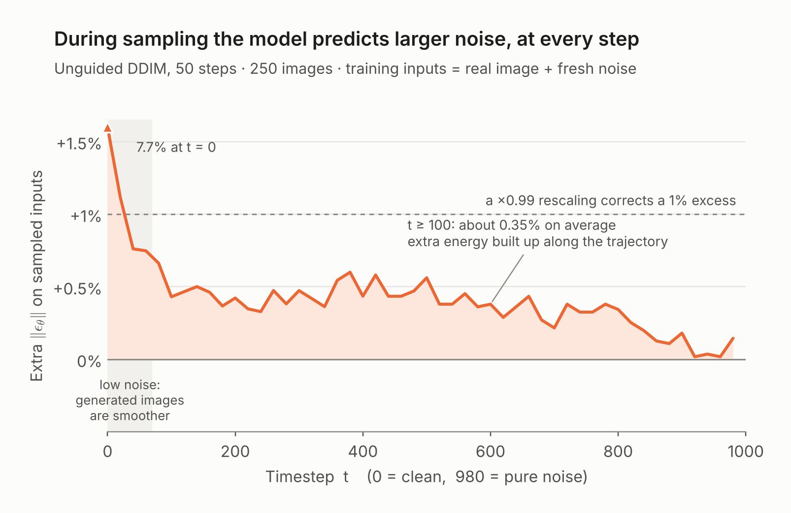
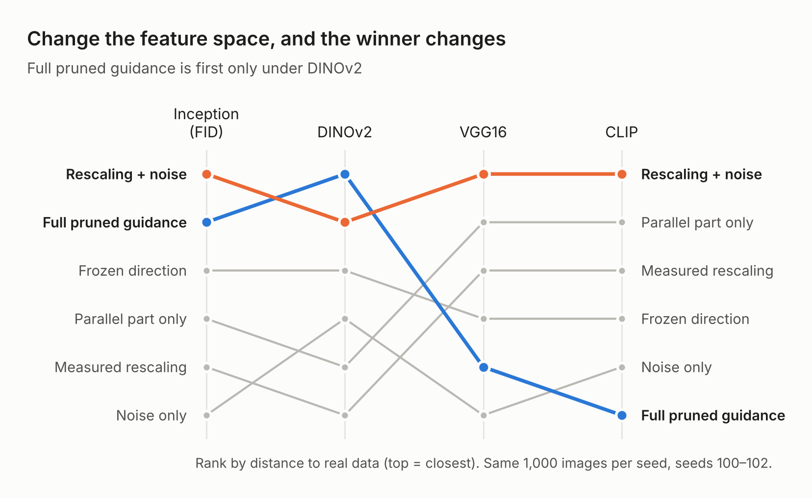

## A model made worse, used as a guide

Take a pretrained diffusion model. Set half of its weights to zero. You now have a broken copy that generates worse images than the original. Now use that broken copy to *guide* the original: at every sampling step, push the original's prediction a little further away from the broken copy's. The samples get better, consistently, and with no training at all.

Do the same with a 4-bit quantized copy, which is also a worse model, and nothing happens.

*Pruned and dropout copies guide; a quantized copy does not. CIFAR-10, DDIM 50 steps, 5,000 images.*

This post is about one question that this small observation raises: **what is guidance actually fixing?**

Guidance has become a standard part of diffusion sampling. Classifier-free guidance (CFG) is used almost everywhere, and Autoguidance showed that a weaker version of the *same* model can serve as the guide. Many training-free variants followed. Most papers explain *why* their guide works with an intuition about the guide model. Few of them ask which part of the sampling error the guidance term removes.

The plan of the post:

1. Split sampling error into three sources. This is the frame for everything that follows.
2. Review the guidance family, from CFG to training-free weak branches.
3. Look at the geometry of the guidance vector. A two-line identity shows that part of it is just a rescaling of the prediction.
4. Connect that rescaling to the exposure-bias literature.
5. Look at guidance from the ODE-solver side.
6. Ask why normal training does not reach whatever guidance finds.
7. End with a note on metrics, and a table of open questions.

Along the way I mark a few places with **"A question worth asking"**. These are points where, as far as I can tell, the existing literature stops short.

## Preliminaries: three sources of sampling error

### Notation

The forward process adds Gaussian noise to a clean image x\_0:

$$
x_t = \sqrt{\bar\alpha_t}\, x_0 + \sqrt{1-\bar\alpha_t}\, \epsilon, \qquad \epsilon \sim \mathcal{N}(0, I)
$$

Write q\_t for the distribution of x\_t produced this way. A network ε\_θ(x\_t, t) is trained to predict the noise:

$$
\mathcal{L}(\theta) = \mathbb{E}_{t,\, x_0,\, \epsilon} \big\| \epsilon_\theta(x_t, t) - \epsilon \big\|^2
$$

The minimizer of this loss is the conditional mean E\[ε | x\_t\]. One fact is worth keeping in mind for later. When the model is uncertain about which noise produced x\_t, the conditional mean averages over the possibilities and shrinks toward zero. So even a perfect model predicts noise with a norm *smaller* than a real noise sample, whose norm is about √d for d pixels.

Sampling runs the process backward. Deterministic samplers such as DDIM can be read as numerical solvers of the probability-flow ODE. At each step, the sampler turns ε\_θ into an estimate of the clean image,

$$
\hat{x}_0 = \frac{x_t - \sqrt{1-\bar\alpha_t}\,\epsilon_\theta(x_t,t)}{\sqrt{\bar\alpha_t}}
$$

and moves to a less noisy x. Write p\_t for the distribution of the x\_t that the *sampler* actually visits. In an ideal world p\_t = q\_t. In practice they differ, and the rest of the post is about how.

### Three places error comes from

Theory splits the final error of a sampler into a score-estimation term and a discretization term (Chen et al., 2023). For our purpose it helps to split the score term once more, by *where* the model is wrong:

| Error type | What it means | Can more training fix it? | Typical fix |
| --- | --- | --- | --- |
| A. Solver error | The ODE is integrated with too few steps. The model may be perfect. | No, it is unrelated to the model | Higher-order solvers, more steps |
| B. Underfitting | The model is wrong on q\_t, the inputs it was trained on | Yes, in principle | Train longer, better architecture or loss weighting |
| C. Trajectory error | The model is wrong on p\_t, inputs it never saw in training | No. The loss is only computed on q\_t | Correct at sampling time, or show the model its own trajectories during training |

*Three places sampling error comes from. Solver error pushes the sampler off the training inputs; once it is off, trajectory error pushes it further.*

The three types feed into each other. Solver error (A) pushes the sampler off q\_t. Once it is off, the model sees unfamiliar inputs and trajectory error (C) appears. Then C pushes the sampler further off. This feedback loop is what the literature calls **exposure bias**.

In the theory, C does not appear as a separate term. Chen et al. measure score error on the true marginals q\_t, and the bound accounts for how errors propagate. In practice, with 50 steps and an imperfect network, how the network behaves *off* q\_t matters a lot.

The frame gives a simple test for any sampling trick: **which of A, B, C does it reduce?** Each answer leads to a different next step. If a trick only reduces A, a better solver can replace it. If it reduces B, training can absorb it. Only C is a gain that standard training cannot reach.

## The guidance family

All the methods in this section share one formula. There is a main prediction ε\_main and a weaker or different prediction ε\_weak, and the sampler extrapolates away from the weak one:

$$
\tilde\epsilon = \epsilon_{\text{main}} + \gamma\,(\epsilon_{\text{main}} - \epsilon_{\text{weak}}) = \epsilon_{\text{main}} + \gamma\, d
$$

Here γ is the guidance strength, and d = ε\_main − ε\_weak is the **guidance vector**. The methods differ only in what plays the role of ε\_weak.

### Classifier-free guidance

In CFG (Ho & Salimans, 2022), ε\_main is the class- or text-conditional prediction and ε\_weak is the unconditional one. The usual story is that CFG samples from a sharpened distribution, proportional to p(x) p(c | x)^(1+γ). It works very well in practice. It also trades diversity for fidelity: samples look cleaner and more typical, but cover less of the data distribution.

### CFG is not what it seems

Bradley & Nakkiran (2024) showed that the usual story is not exact. With a real sampler, CFG does not sample from the sharpened distribution, and the DDPM and DDIM versions of CFG give different results. Their reading is that CFG behaves like a **predictor-corrector** scheme. The base sampler is the predictor; the guidance term acts like a corrector step that pulls samples toward a sharper distribution.

This reframing matters for us. If guidance is partly a *correction step inside the sampler*, then it may be fixing sampling error (types A or C), and not only changing the target distribution.

### Autoguidance: a bad version of yourself

Karras et al. (2024) asked why CFG improves quality at all, and separated two effects. One is sharpening toward the condition. The other is a quality effect that does not need a condition. To isolate the second, they replaced the unconditional model with a **smaller, less-trained version of the same conditional model**. This is Autoguidance. It improved image quality without the diversity loss of CFG, and set strong results on ImageNet.

The key idea from their 2D toy example is **compatibility**. The weak model should make the *same kind* of mistakes as the main model, only more strongly. Then d points from "more wrong" toward "less wrong", and extrapolating along it moves the main model toward the truth. If the weak model fails in its own unrelated way, d mostly encodes that unrelated failure, and guidance hurts.

The compatibility view already explains Figure 1 in a hand-wavy way. Pruning and dropout degrade the network along directions it already relies on. Quantization adds rounding error, which is close to a rescaling plus noise and says little about where the model is wrong.

### Weak branches for free

Autoguidance still needs a second trained model. A line of follow-up work builds the weak branch from the main model itself, with no training:

- **In-situ Autoguidance** (2025) turns dropout on at inference time.
- **S²-Guidance** (2025) stochastically drops blocks of the network.
- Skip-layer variants remove layers, and token-dropping variants remove tokens.
- **How to Guide Your Language Flow** (2026) builds guidance from frozen internal states, and saves the extra forward pass. It also states plainly that the mechanism of autoguidance is still poorly understood.

These methods are mostly justified by the compatibility intuition and by benchmark gains.

### When to guide

Two results show that guidance is not equally useful at every noise level.

- **Applying Guidance in a Limited Interval** (Kynkäänniemi et al., 2024): CFG at high noise mostly hurts diversity, and at very low noise it is unnecessary. Turning it on only in the middle improves both quality and diversity.
- **Weak-to-Strong Segmented Guidance** (2026): for weak-model guidance, most of the benefit comes in the low-noise steps. The authors compare the guidance direction with the optimal velocity field to show this.

> **A question worth asking.** Every method above changes what ε\_weak is, and shows that some choices help. None of them asks what the vector d *contains*. Is d mostly a correction to the model, a correction to the solver, or something else? Is there a part of d that any degraded copy would produce, and a part that only a "compatible" one would? The next section takes one concrete step toward an answer.

## Geometry: the parallel part is just a rescaling

### Splitting the guidance vector

Treat each prediction as one long vector (3×32×32 = 3072 numbers for a CIFAR image). Split d into a part along ε\_main and a part perpendicular to it:

$$
d = c\,\epsilon_{\text{main}} + d_\perp, \qquad c = \frac{\langle d,\, \epsilon_{\text{main}} \rangle}{\|\epsilon_{\text{main}}\|^2}, \qquad \langle d_\perp,\, \epsilon_{\text{main}} \rangle = 0
$$

Put this back into the guidance formula:

$$
\tilde\epsilon = \epsilon_{\text{main}} + \gamma\,(c\,\epsilon_{\text{main}} + d_\perp) = \underbrace{(1 + \gamma c)\,\epsilon_{\text{main}}}_{\text{rescaling}} + \underbrace{\gamma\, d_\perp}_{\text{new direction}}
$$

That is the whole derivation. **The parallel part of any guidance vector does nothing except multiply the main prediction by a scalar.** It needs no information from the weak model beyond one number, c. Only d\_⊥ can carry information about a direction the main model did not already point in.

*The parallel part of a guidance vector is just a rescaling. The drawing is two-dimensional; the real vectors have 3,072 dimensions.*

### What APG found for CFG

Sadat et al. (2025) did this split for CFG, in their method APG. (They split the update relative to the conditional denoised prediction, not ε, but the algebra is the same.) Their finding: at the large guidance scales typical of CFG, the parallel part causes **oversaturation** and artifacts, while the perpendicular part carries most of the quality gain. So APG down-weights the parallel part.

The identity above explains why. With a large γ, the factor 1 + γc can be far from 1, so the image's predicted content is amplified, and colors saturate.

### The small-γ regime looks different

Weak-model guidance usually runs at a much smaller γ. There, the sign of c matters. If c < 0, the parallel part *shrinks* the prediction slightly. A slight shrink of the noise prediction is not a new idea; it is exactly what the exposure-bias literature does on purpose (next section).

In our pruning experiments, c was negative and almost constant over most of the trajectory. The parallel part alone amounted to multiplying ε\_main by a constant a bit below 1. Doing that multiplication directly, with no weak model at all, recovered most of the FID gain of pruned guidance.

*A one-line rescaling recovers most of the gain. CIFAR-10, DDIM 50 steps, 1,000 images.*

So one decomposition gives two opposite roles. In CFG at large γ, the parallel part is a side effect to remove. In weak guidance at small γ, the parallel part may be most of the effect.

> **A question worth asking.** How much of the reported gain of training-free guidance methods is just a rescaling of ε? If a method's guide vector has a consistent negative c, a one-line scaling baseline may explain a large share of its improvement. Most papers in the previous section do not compare against such a baseline. And once the rescaling is removed, does the perpendicular part still help, and does it matter which weak model produced it?

## Exposure bias: why shrinking ε helps

### The problem

During training, the network only sees x\_t drawn from q\_t: a real image plus fresh noise. During sampling, it sees x\_t drawn from p\_t: whatever the sampler produced in the previous steps. The two are close but not equal, and the gap grows along the trajectory. Ning et al. call this **exposure bias**, borrowing the term from sequence models trained with teacher forcing.

One measurable symptom: the norm of the predicted noise is **larger during sampling than during training**, at the same t. Recall from the preliminaries that a well-trained model shrinks its prediction toward zero when it is uncertain. A larger norm at sampling time means the model shrinks less. One reading is that the sampled x\_t carries extra energy that the model mistakes for noise.

*During sampling the model predicts larger noise, at every step. The curve is the extra noise-prediction norm on sampled inputs, compared with real images plus fresh noise.*

### Two families of fixes

| Where the fix lives | Method | What it does |
| --- | --- | --- |
| Training | DDPM-IP (Ning et al., 2023) | Perturbs training inputs with extra noise, to imitate the errors the model will see at sampling time |
| Training | MDSS (Ren et al., 2024) | Rolls the model forward several steps during training, so it learns on its own outputs |
| Sampling | Epsilon Scaling (Ning et al., 2024) | Multiplies ε\_θ by a constant slightly below 1 at each step. Training-free |
| Sampling | Time-Shift Sampler (Li et al., 2024) | Keeps ε\_θ, but picks the timestep whose noise level best matches the current sample |
| Sampling | Frequency regulation (Yu & Zhan, 2025) | Treats low- and high-frequency bands separately, since their energy deviates at different stages |

Epsilon Scaling is the one that connects to the previous section. A guidance vector with c < 0 performs Epsilon Scaling as a by-product.

### Why you can't just train the scaling in

A natural idea: if ε should be scaled by λ at sampling time, why not train the model to predict λε directly? Let's see what that does.

The loss with a scaled target is minimized by

$$
\epsilon_\theta^{*}(x_t, t) = \mathbb{E}[\lambda \epsilon \mid x_t] = \lambda\, \mathbb{E}[\epsilon \mid x_t], \qquad x_t \sim q_t
$$

This is the old model times λ, on the inputs it was trained on. The sampler needs the true noise scale, so it divides by λ again, and we are back where we started. Nothing has changed on q\_t, and nothing has been learned about p\_t.

The lesson is general. **A training loss defines the model only on the training distribution q\_t.** The sampling error comes from evaluating the model on p\_t ≠ q\_t. Reweighting or rescaling the target cannot touch that gap. A training-side fix must change the *inputs* the model sees, which is exactly what DDPM-IP and MDSS do.

### Does Epsilon Scaling fix the cause?

The Epsilon Scaling paper argues that the root cause is prediction error that compounds along the trajectory. But two observations make the picture less clean.

- In their results, the gain from scaling tends to be larger when fewer sampling steps are used. If the cause were only the model being wrong on p\_t, the benefit should not depend so much on step count. Strong step dependence suggests that solver error (type A) is a large part of what scaling corrects.
- The paper also explains why the second-order Heun sampler suffers less from exposure bias. That is a statement about the solver, folded into the same exposure-bias story.

> **A question worth asking.** Has anyone cleanly separated solver error (A) from trajectory error (C) in exposure bias? A simple test: increase the step count until discretization error is negligible. If the optimal scaling factor goes back to 1, scaling was fixing the solver. If it stays below 1, there is a genuine model-side error that training on q\_t cannot see. I could not find a paper that runs this test directly.

## The solver view: is guidance a hidden correction step?

If part of what guidance fixes is solver error, it should look like something a better solver already does. Two ideas from the solver literature are relevant.

### Adding noise can correct accumulated error

EDM (Karras et al., 2022) separated sampler design from model training and studied each on its own. Its stochastic sampler adds a small amount of fresh noise ("churn") at each step and then denoises. The paper's explanation is that the added noise lets the sampler *forget* some of the error accumulated in earlier steps, while the denoising step pulls the sample back toward the data. Too much churn hurts, because it also destroys detail.

This gives one explanation for an otherwise strange fact: small random perturbations of ε at each step, with no information at all, can also improve FID a little. If random noise helps, part of any guidance gain may be churn-like error correction, unrelated to what the weak model knows.

### Higher-order solvers use the difference of consecutive predictions

DDIM is a first-order solver: it assumes the model's prediction is constant over one step. DPM-Solver++ (Lu et al., 2022) relaxes this. Its multistep second-order version keeps the data prediction from the previous step, and adds a correction proportional to the difference between the current and previous predictions:

$$
D_i + \frac{1}{2 r_i}\,(D_i - D_{i-1})
$$

Here D\_i is the predicted clean image at step i, and r\_i is the ratio of consecutive step sizes (in log-SNR). The correction term estimates how the prediction *bends* along the trajectory. A first-order solver ignores that bend.

### Putting the pieces together

Now look at what we know about the perpendicular part of weak-model guidance:

- It is applied as a small extra term at each step, like a correction.
- Weak-model guidance seems to matter most in the low-noise steps (Weak-to-Strong Segmented Guidance), which is also where the trajectory bends most.
- Both the guidance term and the second-order correction vanish when the main prediction is already right.

> **A question worth asking.** Is small-γ weak-model guidance partly a disguised higher-order solver? A direct test costs only forward passes: along the sampling trajectory, compute the angle between d\_⊥ and the second-order correction direction (D\_i − D\_{i−1}, converted to the same space). A small angle would mean the weak model is an expensive way to get a correction that DPM-Solver++ gives for free. An angle close to random would mean d\_⊥ carries information that no solver can produce. Either answer is informative.

## Why doesn't training get there on its own?

Suppose weak-model guidance really does improve samples. A strange question follows. The guided prediction is a fixed function of the model's own weights. Why didn't gradient descent find a set of weights that already produces it?

### A first-order argument

Let θ\* be the trained weights, and build the weak model by a weight perturbation δ, so ε\_weak = ε\_{θ\*+δ}. For a small δ, linearize with the Jacobian J = ∂ε\_θ/∂θ at θ\*:

$$
\epsilon_{\theta^*+\delta} \approx \epsilon_{\theta^*} + J\delta \quad\Rightarrow\quad d = \epsilon_{\theta^*} - \epsilon_{\theta^*+\delta} \approx -J\delta
$$

So the guided prediction is

$$
\tilde\epsilon = \epsilon_{\theta^*} + \gamma d \approx \epsilon_{\theta^*} - \gamma J\delta \approx \epsilon_{\theta^* - \gamma\delta}
$$

To first order, guidance evaluates a model whose weights moved a little *away* from the weak model. Now use the fact that θ\* is a minimum of the training loss, so its gradient is zero:

$$
\mathcal{L}(\theta^* - \gamma\delta) - \mathcal{L}(\theta^*) = -\gamma\, \nabla\mathcal{L}(\theta^*)^\top \delta + O(\gamma^2\|\delta\|^2) = O(\gamma^2\|\delta\|^2)
$$

The guided model is **no better on the training loss** to first order, and slightly worse at second order. If its samples are nonetheless better, the improvement must come from something the training loss does not measure: solver error (A), or behavior on p\_t instead of q\_t (C). Underfitting (B) is ruled out by this argument, if its assumptions hold.

This also answers the question above. Gradient descent did not go there because, by the only measure it has, there is no "there" to go to.

### Where the argument can break

The argument is an intuition, not a theorem. Three assumptions are shaky in practice:

1. **The perturbation is not small.** Zeroing half the weights is far outside the linear regime.
2. **The weights are an EMA.** Released diffusion checkpoints usually use an exponential moving average of the training weights. The EMA is not exactly a minimum of the training loss, so the gradient term need not vanish.
3. **Training used dropout.** The trained model minimizes an average over dropout masks, not the loss of the deterministic network used at inference. This may also explain why inference-time dropout works as a guide.

Each of these leaves room for B to contribute. That is why the argument needs a measurement, not just a derivation.

### What does the trained denoiser actually learn?

A related line of work asks how a trained denoiser differs from the ideal one. Kadkhodaie et al. (2024) show that denoisers that generalize, instead of memorizing, carry a strong inductive bias toward geometry-adaptive harmonic bases. In plain words: the network does not learn the exact optimal denoiser for its finite training set, and the way it deviates is structured. Guidance may be exploiting one such structured deviation.

> **A question worth asking.** Measure it. On real images with fresh noise (q\_t), compare the denoising loss of ε\_main and of the guided prediction, timestep by timestep. If the guided prediction has lower loss, the gain is underfitting (B), and training could absorb it. If the loss is unchanged or higher while samples improve, the gain lives off the training distribution (A or C). That would be a clean demonstration that **a better sampler and a better denoiser are not the same thing.**

## A note on metrics

Everything above is judged by distribution metrics, and those metrics have their own biases. This matters most when the effect being measured is small, which is the case for small-γ guidance and for ε rescaling.

- **FID depends on its feature space.** Stein et al. (2023) ran large human studies and found that Inception features, which FID uses, agree poorly with human judgments for modern generators. They recommend Fréchet distance in DINOv2 feature space instead.
- **FID makes strong assumptions.** Jayasumana et al. (2024) point out that FID models features as Gaussian and is biased at small sample sizes. They propose CMMD, which uses CLIP features and a kernel distance with no Gaussian assumption.

We ran into this directly. When comparing small corrections to ε, the ranking of methods sometimes changed between Inception, DINOv2, CLIP and VGG feature spaces. A method that looked best under FID was not best under DINOv2, and the reverse.

*Change the feature space, and the winner changes. Full pruned guidance is first only under DINOv2.*

The practical advice is simple. For any claim of the form "trick X explains most of the gain of method Y", report at least two feature spaces, and say when they disagree. A disagreement is a finding, not noise to hide.

## Open questions

The questions raised along the way, in one place:

| Question | What existing work shows | What seems to be missing |
| --- | --- | --- |
| What does the guidance vector d contain? | Compatible weak models help; incompatible ones do not (Autoguidance) | A decomposition of d into parts with different causes |
| How much of a guidance gain is just rescaling ε? | The parallel part of d is exactly a rescaling; APG removes it for CFG | Rescaling baselines in training-free guidance papers |
| Does exposure-bias correction fix the solver or the model? | Epsilon Scaling helps; its gain depends on step count | A step-count sweep that separates solver error from trajectory error |
| Is weak guidance a disguised higher-order solver? | Guidance acts like a corrector; DPM-Solver++ corrects with consecutive predictions | A direct comparison of the two correction directions |
| Does guidance lower the training loss? | First-order argument says no, under shaky assumptions | A per-timestep measurement on q\_t |
| Which metric should we trust for small effects? | DINOv2 agrees better with humans than Inception | Routine multi-feature-space reporting |

If I had to compress the post into one sentence: **before crediting a guide model with a gain, subtract what a rescaling and a better solver would have given for free.** What is left is the part worth explaining.

## References

1. Ho, J., & Salimans, T. (2022). Classifier-Free Diffusion Guidance.
2. Bradley, A., & Nakkiran, P. (2024). Classifier-Free Guidance is a Predictor-Corrector.
3. Karras, T., et al. (2024). [Guiding a Diffusion Model with a Bad Version of Itself](https://arxiv.org/abs/2406.02507). NeurIPS 2024.
4. [In-situ Autoguidance](https://arxiv.org/abs/2510.17136) (2025).
5. [S²-Guidance](https://arxiv.org/abs/2508.12880) (2025).
6. [How to Guide Your Language Flow](https://arxiv.org/abs/2609.19356) (2026).
7. Kynkäänniemi, T., et al. (2024). Applying Guidance in a Limited Interval Improves Sample and Distribution Quality in Diffusion Models. NeurIPS 2024.
8. [Improving Diffusion Generalization with Weak-to-Strong Segmented Guidance](https://arxiv.org/abs/2603.20584) (2026).
9. Sadat, S., et al. (2025). [Eliminating Oversaturation and Artifacts of High Guidance Scales in Diffusion Models](https://arxiv.org/abs/2410.02416). ICLR 2025.
10. Ning, M., et al. (2023). [Input Perturbation Reduces Exposure Bias in Diffusion Models](https://proceedings.mlr.press/v202/ning23a.html). ICML 2023.
11. Ning, M., et al. (2024). [Elucidating the Exposure Bias in Diffusion Models](https://arxiv.org/abs/2308.15321). ICLR 2024.
12. Li, M., et al. (2024). [Alleviating Exposure Bias in Diffusion Models through Sampling with Shifted Time Steps](https://arxiv.org/abs/2305.15583). ICLR 2024.
13. Ren, Z., et al. (2024). Multi-Step Denoising Scheduled Sampling. AAAI 2024.
14. Yu & Zhan (2025). [Frequency Regulation for Exposure Bias Mitigation](https://arxiv.org/abs/2507.10072).
15. Karras, T., et al. (2022). Elucidating the Design Space of Diffusion-Based Generative Models. NeurIPS 2022.
16. Lu, C., et al. (2022). [DPM-Solver++](https://arxiv.org/abs/2211.01095).
17. Chen, S., et al. (2023). Sampling is as easy as learning the score. ICLR 2023.
18. Kadkhodaie, Z., et al. (2024). Generalization in Diffusion Models Arises from Geometry-Adaptive Harmonic Representations. ICLR 2024.
19. Stein, G., et al. (2023). Exposing Flaws of Generative Model Evaluation Metrics. NeurIPS 2023.
20. Jayasumana, S., et al. (2024). Rethinking FID: Towards a Better Evaluation Metric for Image Generation. CVPR 2024.
